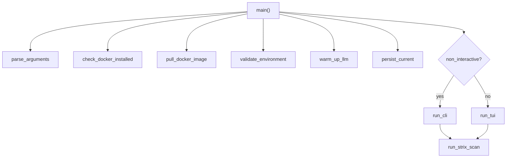
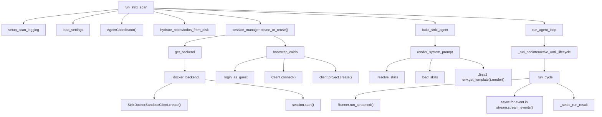
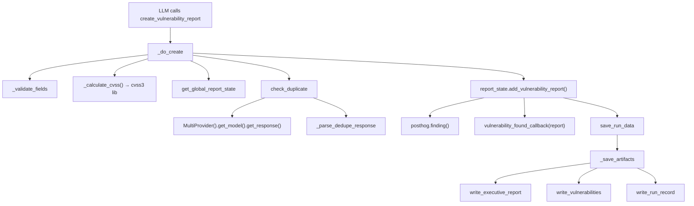
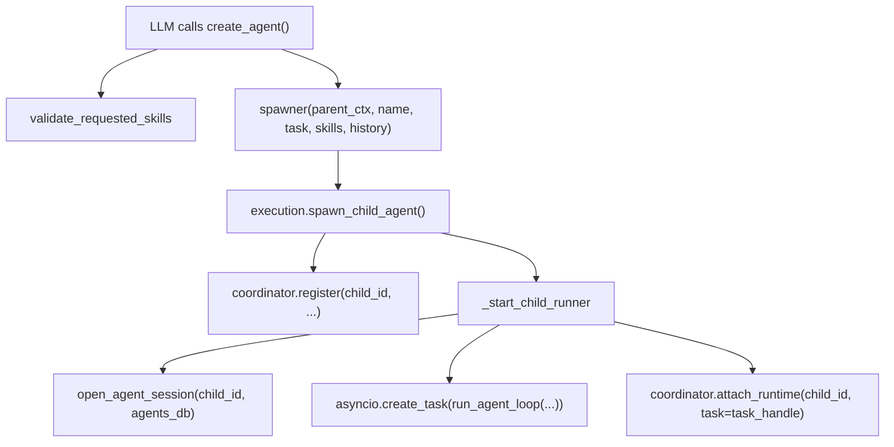
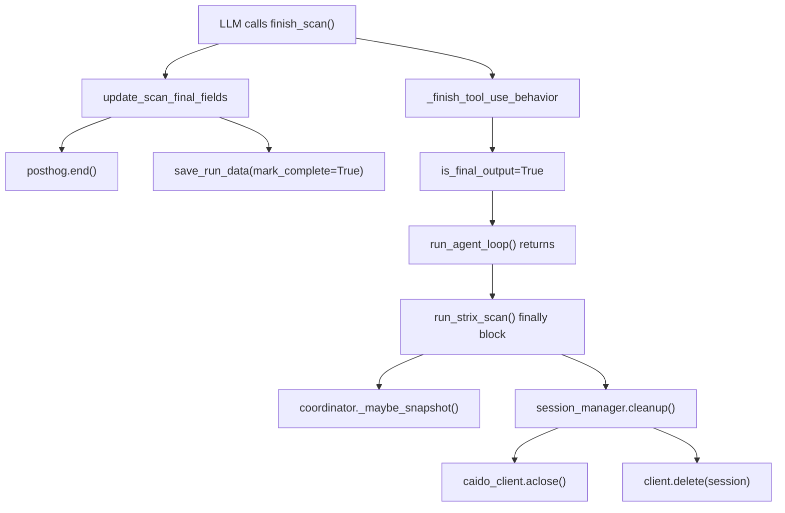

# CALL_GRAPH

Parent document: /CLAUDE.md
Related documents:
- /docs/architecture/RUNTIME_FLOWS.md
- /docs/architecture/DEPENDENCY_GRAPH.md

Read this when:
- Tracing function-level call paths from entry points
- Debugging a crash or unexpected exit path
- Understanding which functions are on the hot path

Purpose:
- Key call paths from entry points to core modules

Scope:
- Important paths only; not exhaustive function list

---

## Main Entry Point → Scan Start

## run_strix_scan → Agent Execution

## Tool Call → Vulnerability Filed

## Tool Call → Child Agent Spawned

## Scan Completion Path

---

## Known Gaps / Uncertainties

- Interactive TUI event dispatch not traced.
- Error recovery path for `image_strips >= 3` in `_run_cycle` not fully traced (falls through to raise after strip exhaustion).
- Exactly when `coordinator._maybe_snapshot()` is called vs. `run_agent_loop` finishing is not fully sequenced (it's called at multiple points inside the coordinator methods too).
