# DEPENDENCY_GRAPH

Parent document: /CLAUDE.md
Related documents:
- /docs/architecture/REPOSITORY_MAP.md
- /docs/architecture/CHANGE_BLAST_RADIUS.md
- /docs/architecture/CALL_GRAPH.md

Read this when:
- Assessing coupling between modules before making changes
- Understanding which module imports depend on a given module

Purpose:
- Module-level internal import graph + key third-party dependencies

Scope:
- Internal import graph and critical external dependencies only

---

## Internal Module Dependency Graph

```mermaid
graph TD
    interface_main["interface/main.py"] --> interface_cli
    interface_main --> interface_tui
    interface_main --> interface_utils
    interface_main --> core_runner
    interface_main --> core_paths
    interface_main --> config
    interface_main --> config_models
    interface_main --> report_state
    interface_main --> report_writer
    interface_main --> telemetry

    interface_cli["interface/cli.py"] --> core_runner
    interface_cli --> config
    interface_cli --> report_state
    interface_cli --> runtime_session_manager
    interface_cli --> interface_utils

    core_runner["core/runner.py"] --> agents_factory
    core_runner --> config
    core_runner --> config_models
    core_runner --> core_agents
    core_runner --> core_execution
    core_runner --> core_hooks
    core_runner --> core_inputs
    core_runner --> core_paths
    core_runner --> core_sessions
    core_runner --> runtime_session_manager
    core_runner --> telemetry_logging
    core_runner --> tools_notes
    core_runner --> tools_todo

    core_execution["core/execution.py"] --> core_agents
    core_execution --> core_inputs
    core_execution --> core_sessions

    agents_factory["agents/factory.py"] --> agents_prompt
    agents_factory --> tools_agents_graph
    agents_factory --> tools_finish
    agents_factory --> tools_load_skill
    agents_factory --> tools_notes
    agents_factory --> tools_proxy
    agents_factory --> tools_reporting
    agents_factory --> tools_thinking
    agents_factory --> tools_todo
    agents_factory --> tools_web_search

    agents_prompt["agents/prompt.py"] --> skills
    agents_prompt --> utils_resource_paths

    tools_reporting["tools/reporting/tool.py"] --> report_state
    tools_reporting --> report_dedupe

    tools_agents_graph["tools/agents_graph/tools.py"] --> core_agents
    tools_agents_graph --> skills

    report_state["report/state.py"] --> core_paths
    report_state["report/state.py"] --> report_usage
    report_state --> report_writer
    report_state --> telemetry

    report_dedupe["report/dedupe.py"] --> config
    report_dedupe --> config_models
    report_dedupe --> report_state

    config["config/__init__.py + loader.py"] --> config_settings
    config_models["config/models.py"] --> config

    runtime_session_manager["runtime/session_manager.py"] --> config
    runtime_session_manager --> runtime_backends
    runtime_session_manager --> runtime_caido_bootstrap

    runtime_backends["runtime/backends.py"] --> runtime_docker_client

    telemetry["telemetry/posthog.py + scarf.py"] --> config
    telemetry --> telemetry_common

    skills["skills/__init__.py"] --> utils_resource_paths
```

---

## Hidden Coupling Points

1. **`ReportState` global singleton** — `tools/reporting/tool.py` and `report/dedupe.py` both call `get_global_report_state()` which reads a module-level variable set in `interface/cli.py` / `interface/main.py`. Any tool that files a vulnerability report depends on this being set before the scan starts.

2. **`_cached` settings** — `config/loader.py` uses a module-level `_cached` variable. The first call to `load_settings()` memoizes forever unless `apply_config_override()` is called. All modules that call `load_settings()` share this singleton.

3. **`_SESSION_CACHE` dict** — `runtime/session_manager.py` has a module-level dict. One container per `scan_id`. If the same Python process runs two scans with the same `scan_id`, they silently share the container.

4. **`AgentCoordinator` passed via context dict** — The coordinator is not imported by tools; it is injected into the SDK `context` dict at `run_strix_scan()` time and extracted by `coordinator_from_context()` in each tool. This is intentional decoupling but makes the coupling invisible at import time.

5. **`_global_report_state` in `report/state.py`** — Both set via `interface/cli.py` AND referenced inline by `tools/reporting/tool.py` and `report/dedupe.py`. The call-graph coupling is: `cli.py → report/state.py → tools/reporting/tool.py` but the import graph doesn't show this.

---

## Key Third-Party Dependencies

| Package | Version | Used For |
|---------|---------|---------|
| `openai-agents[litellm]` | 0.14.6 | Core agent SDK, streaming runner, session storage, sandbox |
| `pydantic` | ≥2.11.3 | Settings models, tool argument validation |
| `pydantic-settings` | ≥2.13.0 | Env var + JSON settings loading |
| `rich` | latest | CLI console rendering, live status display |
| `textual` | ≥6.0.0 | Interactive TUI framework |
| `docker` | ≥7.1.0 | Container lifecycle via Python SDK |
| `requests` | ≥2.32.0 | HTTP requests (telemetry, install scripts) |
| `cvss` | ≥3.2 | CVSS 3.1 score calculation |
| `caido-sdk-client` | ≥0.2.0 | Caido proxy GraphQL client |
| `jinja2` | (transitive) | System prompt template rendering |

---

## Known Gaps / Uncertainties

- `config/models.py` imports not fully traced — `normalize_model_name`, `configure_sdk_model_defaults`, `uses_chat_completions_tool_schema` dependencies unclear.
- `strix/interface/tui/` imports not traced.
- Lazy import patterns in `tools/reporting/tool.py` (imports `cvss` inline inside `_calculate_cvss`) mean circular-import-avoidance hacks exist.
