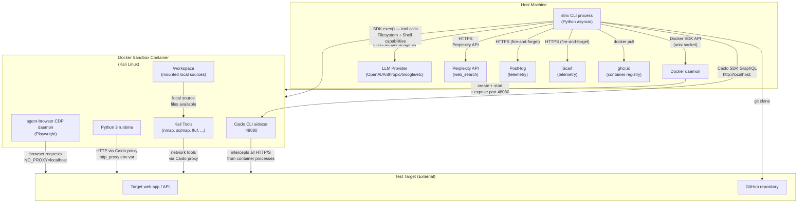

# SERVICE_TOPOLOGY

Parent document: /CLAUDE.md
Related documents:
- /docs/architecture/RUNTIME_DEPENDENCY_TREE.md
- /docs/integrations/EXTERNAL_INTEGRATIONS.md
- /docs/operations/OPERATIONAL_FAILURE_GRAPH.md

Read this when:
- Planning infrastructure changes
- Understanding how host and container communicate
- Reviewing network boundaries

Purpose:
- Service/component topology and communication paths

Scope:
- Runtime topology only; not code structure

---

## Service Topology

---

## Communication Details

### Host → Container (SDK exec / Shell / Filesystem)
- Transport: Docker SDK exec API (unix socket)
- Auth: Docker daemon socket
- Direction: Host → Container (one-way command execution)
- Result: stdout/stderr returned to host

### Host → Caido (GraphQL API)
- Transport: HTTP to `localhost:<exposed_port>`
- Port exposed: Container port 48080 → random host port
- Auth: Guest token obtained via `loginAsGuest` GraphQL mutation run inside container
- Used for: proxy history queries (`list_requests`, `view_request`, `repeat_request`, `list_sitemap`)

### Container → Target (via Caido proxy)
- All HTTP/HTTPS traffic from container processes routes through Caido sidecar
- Set via environment variables: `http_proxy`, `https_proxy`, `ALL_PROXY`
- Exception: `NO_PROXY=localhost,127.0.0.1` (agent-browser CDP bypass)
- Effect: all scan traffic is captured and queryable via Caido SDK

### Host → LLM Provider
- Transport: HTTPS
- Auth: `LLM_API_KEY` env var (or provider-specific credentials: Vertex AI ADC, AWS credentials, etc.)
- Via: LiteLLM proxy inside openai-agents SDK
- Model routing: `MultiProvider().get_model(normalize_model_name(model_str))`

### Container → Internet (tool downloads, wordlists)
- Container has outbound internet access (via Docker networking)
- Caido proxy intercepts and logs this traffic too
- Agents can install tools via `apt`, `pip`, `go install`, `npm`

---

## Network Boundaries

| Boundary | Direction | Protocol | Notes |
|----------|-----------|----------|-------|
| Host → Docker daemon | Bidirectional | Unix socket | |
| Host → Container exec | Host→Container | Docker exec API | SDK-managed |
| Container → Target | Outbound | HTTP/HTTPS via Caido | Caido intercepts |
| Host → LLM | Outbound | HTTPS | Per-turn LLM call |
| Host → Caido sidecar | Host→Container | HTTP GraphQL | Port-forwarded |
| Host → Telemetry | Outbound | HTTPS | Fire-and-forget |

---

## Known Gaps / Uncertainties

- agent-browser CDP port (used for Playwright in container) not fully documented — `NO_PROXY` suggests it runs on localhost.
- Multi-container networking not supported — only one container per scan.
- Whether Caido intercepts `exec_command`-spawned subprocesses that explicitly unset proxy env vars is unknown.
