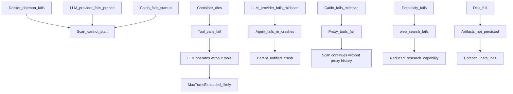

# OPERATIONAL_FAILURE_GRAPH

Parent document: /CLAUDE.md
Related documents:
- /docs/operations/FAILURE_MODES.md
- /docs/architecture/RUNTIME_DEPENDENCY_TREE.md
- /docs/architecture/SERVICE_TOPOLOGY.md

Read this when:
- Performing cascading failure analysis
- Planning for infrastructure resilience
- Diagnosing compound failures

Purpose:
- Failure propagation: what breaks when each dependency fails

Scope:
- Runtime failures only; not code bugs

---

## Docker Daemon Failure

```
Docker daemon fails
    │
    ├─ [HARD] Pre-flight: sys.exit(1) — scan never starts
    │
    └─ [HARD] Mid-scan: container cannot be created for new scans
               session_manager.create_or_reuse() raises
               run_strix_scan() propagates exception
               run_cli() catches and prints error
               scan aborted — no artifacts written
               (active scans using existing containers may continue
                until their container exits naturally)
```

---

## Container (Sandbox) Failure

```
Running container dies mid-scan
    │
    ├─ Shell/Filesystem tool calls return errors
    │     → Errors returned as strings to LLM
    │     → LLM may continue attempting tools or call finish_scan
    │
    └─ Proxy tools fail (Caido no longer reachable)
          → proxy tool calls return errors to LLM
          → LLM cannot query proxy history
    
    Impact: Scan degrades to LLM-only (no tool execution); 
    MaxTurnsExceeded likely if agent cannot call lifecycle tool.
    Resume possible if agents.json was written before container died.
```

---

## LLM Provider Failure

```
LLM API becomes unavailable
    │
    ├─ [PRE-SCAN] warm_up_llm() fails → sys.exit(1)
    │
    └─ [MID-SCAN] SDK retry exhausted → AgentsException
          In non-interactive mode:
            → exception propagates → run_strix_scan() logs + re-raises
            → scan aborted; run.json status=failed
            → resume possible after provider recovers
          In interactive mode:
            → agent set to "failed" status
            → parent notified with crash message
            → other agents continue if healthy
    
    Deduplication LLM call failure:
    → check_duplicate() returns is_duplicate=False
    → vulnerability report filed (permissive failure)
```

---

## Caido Sidecar Failure

```
Caido fails to start
    │
    └─ bootstrap_caido() fails after 10 retries
          → run_strix_scan() raises RuntimeError
          → scan aborted

Caido crashes mid-scan:
    │
    └─ proxy tools return errors
          → LLM cannot query proxy history
          → list_requests, view_request, repeat_request all fail
          → HTTP traffic no longer captured
          → Scan degrades: agents rely on direct tool execution only
             (exec_command, Python scripts) without proxy interception
```

---

## LLM Provider Failure (Deduplication Only)

```
LLM API fails during check_duplicate()
    │
    └─ check_duplicate() catches all exceptions
          → returns {is_duplicate: False, confidence: 0.0}
          → vulnerability report IS filed
    
    Net effect: Potential for duplicate vulnerability reports in output.
    User can deduplicate manually post-scan.
```

---

## Perplexity API Failure

```
Perplexity API unavailable
    │
    └─ web_search tool returns error string
          → LLM may retry or continue without web context
          → Scan continues with reduced research capability
          → No scan abort
    
    Impact: Reduced context for payload research;
    agents must rely on skills and embedded knowledge.
```

---

## Disk Full / Disk Write Failure

```
Disk write fails during save_run_data()
    │
    └─ _save_artifacts() catches OSError, logs exception
          → Vulnerability data in-memory but NOT on disk
          → run.json may be stale or missing
          → agents.json may not be updated
    
    Impact: Data loss (vulnerability reports lost if process exits);
    resume may fail or start with partial state.
```

---

## Failure Propagation Summary



---

## Known Gaps / Uncertainties

- Container OOM kill behavior not characterized.
- Network partition between host and container (unusual but possible in VMs) not analyzed.
- What happens to active asyncio tasks when `session_manager.cleanup()` raises during scan teardown is not fully documented.
